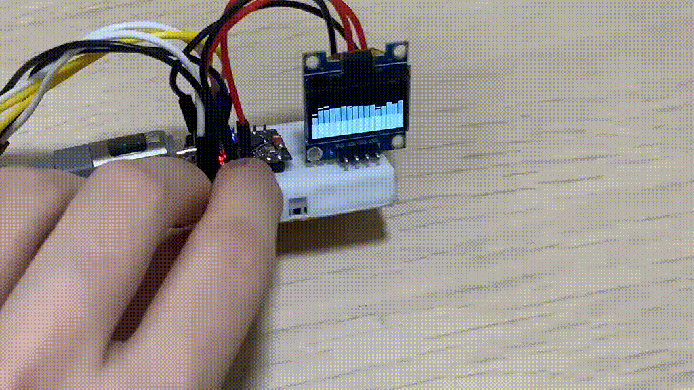

# Audio Visualizer (ESP-32 Version)

An real-time audio visualizer project using an ESP32 microcontroller, an I2S microphone, and an SSD1306 OLED display. This project captures audio data, processes it using Fast Fourier Transform (FFT), and displays the frequency spectrum as a bar graph on the OLED display.

## Features
- **Real-time Visualization:** Uses FFT to analyze audio frequencies in real-time.
- **16 Frequency Bands:** Segments audio into 16 distinct bands for detailed visualization.
- **Peak Detection:** Includes a peak-decay feature for better visual feedback.
- **I2S Audio Input:** High-quality digital audio acquisition using I2S protocol.
- **Compact OLED Display:** Uses a 128x64 SSD1306 I2C display.

## Demonstration

## Pinout

The following pins are used in the `code.ino` file:

| Component | Pin | ESP32 GPIO |
| :--- | :--- | :--- |
| **SSD1306** | SDA | GPIO 8 |
| **SSD1306** | SCL | GPIO 9 |
| **I2S Mic** | WS (Word Select) | GPIO 4 |
| **I2S Mic** | SCK (Serial Clock) | GPIO 5 |
| **I2S Mic** | SD (Serial Data) | GPIO 6 |

*(Ensure your ESP32 board supports these pins or adjust the definitions in `code.ino` as needed.)*

## BOM (Bill of Materials)

| Component | Description |
| :--- | :--- |
| **ESP32** | ESP32 Development Board |
| **I2S Microphone** | e.g., INMP441 I2S Microphone Module |
| **OLED Display** | SSD1306 128x64 I2C OLED Display |
| **Wires** | Jumper wires (male-to-male/female-to-male) |
| **Breadboard** | Optional, for prototyping |
